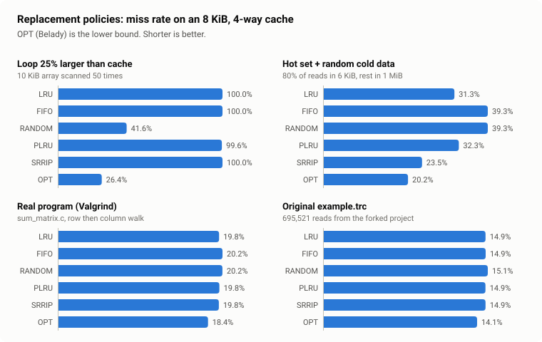
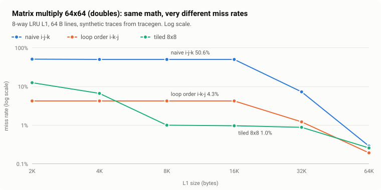
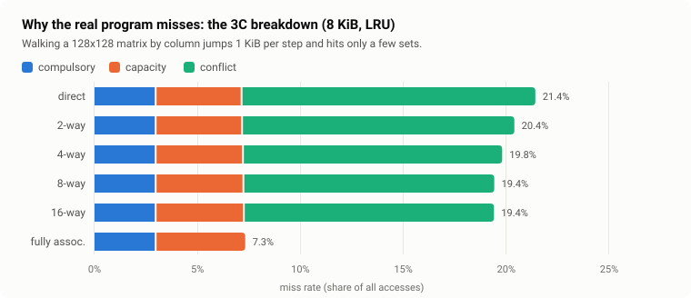
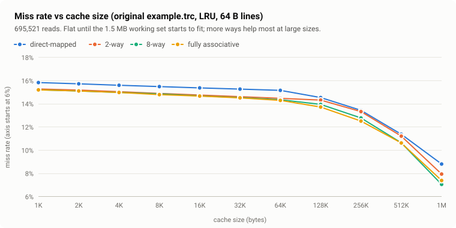

# cachesim: a fast, tested CPU cache simulator

[](https://github.com/zer0xor1/LRU_Cache_Simulator/actions/workflows/ci.yml)

A C++17 simulator for set-associative CPU caches and multi-level cache hierarchies.
Give it a memory trace (from Valgrind, a generator, or a file) and a cache shape. It tells you
what hits, what misses, **why** each miss happened, how much memory traffic you cause, and the
average memory access time.

This started as a fork of a small 2019 LRU simulator. It is now a ground-up rewrite: the
original had undefined behaviour and silently simulated the wrong cache size for its own
example config. The rewrite reproduces the original's correct results exactly, fixes the
bugs, and adds the features a real cache study needs.

<picture>
  <source media="(prefers-color-scheme: dark)" srcset="docs/images/policies-dark.svg">
  
</picture>

## Highlights

* **Six replacement policies.** LRU in O(1) with an intrusive list, FIFO, seeded Random,
  tree pseudo-LRU (what real L1/L2 caches use), SRRIP (scan resistant, from RRIP-style LLCs),
  and Belady's OPT as the theoretical lower bound.
* **Write policies.** Write-back or write-through, with or without write-allocate. Dirty
  victims become write-backs to the next level.
* **Multi-level hierarchies.** L1, L2, L3 and memory from one INI file, with per-level
  latencies, traffic counts and simulated AMAT.
* **3C miss classification.** Every miss is labelled compulsory, capacity or conflict, using a
  fully associative shadow cache per level.
* **Real traces.** Reads Valgrind Lackey, CMU cachelab, Dinero and plain address formats. It
  streams the trace in constant memory, so you can pipe Valgrind straight in.
* **Design-space sweeps.** `--sweep` runs a grid of sizes, ways, line sizes and policies in
  parallel and writes CSV.
* **Interactive web visualizer.** `web/index.html` steps through a trace and shows the address
  bits, the sets, the policy state and an explanation of every decision.
* **Tested hard.** 64 test cases (179k checks), differential testing against a naive reference
  model on 600 random configurations, mutation testing, regression against the original
  program, ASan and UBSan, and a C++ vs JavaScript cross-check.
* **About 18x faster** than the original end to end, with identical results.

## Quick start

```sh
cmake -S . -B build -DCMAKE_BUILD_TYPE=Release
cmake --build build -j
ctest --test-dir build            # or: make test

build/cachesim traces/example.trc                     # 32 KiB, 64 B lines, 8-way LRU
build/cachesim -s 16K -b 64 -a 4 -p plru traces/example.trc
build/cachesim configs/legacy_example.cfg traces/example.trc   # the original two-file usage
```

No CMake? One line works too:

```sh
g++ -std=c++17 -O2 -pthread -Iinclude src/*.cpp apps/cachesim.cpp -o cachesim
```

Requirements: a C++17 compiler and CMake 3.16+. Tested with GCC 13 and Clang 18 on Linux;
CI also builds on macOS, and on Windows with MSVC as a best-effort job. Python 3 and Node are
only needed for the chart, benchmark and web cross-check scripts.

## Using it

**A three-level hierarchy on a real program:**

```text
$ build/cachesim -c configs/intel_like.cfg traces/real/sum_matrix_lackey.trc

level   size       line   assoc   sets     policy  write   tag/idx/off  latency
L1d     32 KiB     64 B   8-way   64       PLRU    WB+WA   52/6/6       4 cyc
L2      1 MiB      64 B   16-way  1,024    PLRU    WB+WA   48/10/6      14 cyc
L3      8 MiB      64 B   16-way  8,192    SRRIP   WB+WA   45/13/6      42 cyc
memory                                                                  200 cyc

level        accesses         hits      misses  miss rate  compulsory   capacity   conflict  evictions  writebacks
L1d           118,716       96,356      22,360    18.835%       3,575      4,346     14,439     21,848       2,640
L2             25,000       21,425       3,575    14.300%       3,575          0          0          0           0
L3              3,575            0       3,575   100.000%       3,575          0          0          0           0

L1 reads  88,075 (miss 22.583%)   writes 30,641 (miss 8.061%)
memory    3,575 line reads (223.44 KiB), 0 line writes (0 B)
AMAT      13.92 cycles
```

Most L1 misses here are **conflict** misses. The program walks a 128x128 matrix by column, so
each step jumps 1 KiB and lands in the same few sets. That is the kind of answer the 3C split
gives you.

**Capture and simulate your own program:**

```sh
gcc -O1 -g -o prog prog.c
valgrind --tool=lackey --trace-mem=yes ./prog 2>&1 >/dev/null | build/cachesim -c configs/l1d_32k_8way.cfg -
```

**Watch every decision** (`-v` prints each access and what each level did):

```text
$ build/cachesim -v -c configs/teaching_small.cfg traces/samples/conflict_thrash.trc
R 0x10000000 8  | L1 miss(compulsory) set 0
R 0x10001000 8  | L1 miss(compulsory) set 0
R 0x10002000 8  | L1 miss(compulsory) set 0 evict 0x10000000
```

**Sweep a design space** (runs in parallel, writes CSV):

```sh
build/cachesim --sweep --sizes 1K-1M --assocs 1,2,4,8,full --policies lru,plru,opt traces/example.trc > sweep.csv
```

**Generate workloads with known behaviour:**

```sh
build/tracegen matmul --n 64           | build/cachesim -q -s 8K -a 8 -   # L1 miss rate 0.506
build/tracegen matmul --n 64 --tile 8  | build/cachesim -q -s 8K -a 8 -   # L1 miss rate 0.010
```

Other outputs: `--json` for machine-readable results, `-q` for one line per level.
Run `build/cachesim --help` for every option.

### Config files

The original three-line format still works. The new format adds levels and policies:

```ini
[L1d]
size     = 32K
block    = 64
assoc    = 8          # or "full"
policy   = plru       # lru | fifo | random | plru | srrip | opt
write    = write-back # or write-through
allocate = yes        # write-allocate on a store miss
latency  = 4

[L2]
size     = 1M
assoc    = 16
latency  = 14

[memory]
latency  = 200
```

Errors point at the line and say what to change, for example
`x.cfg:3: unknown key 'bogus'` or
`L1: cache size must be a multiple of block size x associativity (192 bytes)`.

## What the simulator shows

<picture>
  <source media="(prefers-color-scheme: dark)" srcset="docs/images/matmul_tiling-dark.svg">
  
</picture>

Same arithmetic, three loop orders. Tiling keeps a working set that fits in L1, so the miss
rate drops from about 50% to about 1% until the cache is big enough to hold whole matrices.

<picture>
  <source media="(prefers-color-scheme: dark)" srcset="docs/images/three_c-dark.svg">
  
</picture>

More ways remove only a little of the conflict problem for the column walk. Only full
associativity (or changing the access pattern) fixes it.

<picture>
  <source media="(prefers-color-scheme: dark)" srcset="docs/images/miss_rate_vs_size-dark.svg">
  
</picture>

The original project's trace touches about 1.5 MB of distinct data and reuses little of it,
so the miss rate stays near 15% until the cache gets large. At 1 MiB the 8-way cache beats
the fully associative one: LRU is not optimal, and full associativity does not guarantee
fewer misses.

The numbers behind every chart are in [`docs/data/`](docs/data). Rebuild them with
`make charts`.

## How it works

```text
trace file / stdin ──> streaming parser ──> Simulator ──> L1 ──> L2 ──> ... ──> memory
                       (no per-line          (splits        each level: flat arrays of
                        allocation)           accesses       block numbers, a replacement
                                              into lines)    policy, a 3C shadow cache
```

* Each level stores its block numbers in one flat array, set after set. An 8-way lookup reads
  one or two host cache lines. Ways fill in order and lines are never invalidated, so the
  valid lines of a set are always ways `0..fill_count-1`. There is no valid-bit check.
* Above 32 ways (for example a fully associative cache) a linear scan gets slow, so the level
  also keeps an open-addressing hash index from block to line.
* LRU keeps a doubly linked list per set inside flat `prev`/`next` arrays. Every operation is
  O(1), with no allocation.
* OPT needs the future. One backward pass over the trace computes, for every access, when the
  same block is used next. The victim is the line whose next use is furthest away.

The full write-up, with complexity per policy and the hierarchy model, is in
[docs/DESIGN.md](docs/DESIGN.md).

## Testing

| Layer | What it checks |
|---|---|
| Unit tests | Parsers, geometry, each policy on hand-worked examples, write policies, AMAT, traffic. |
| Textbook cases | Silberschatz reference string: FIFO 15, LRU 12, OPT 9 faults. Belady's anomaly for FIFO. |
| Differential | 600 random configurations against a naive reference model that shares no code. Every counter must match. |
| Mutation | Seven deliberate bugs (PLRU off-by-one, SRRIP insert value, OPT choosing nearest, ...). The suite catches all seven. |
| Regression | Hit and miss counts of the original program on 8 configurations, matched exactly. |
| Sanitizers | Full suite under AddressSanitizer and UndefinedBehaviorSanitizer, GCC and Clang with `-Werror`. |
| Cross-language | The JavaScript engine of the web visualizer matches the C++ binary on 90 trace and configuration pairs. |

```sh
make test       # unit, property, regression and CLI tests
make asan       # the same under ASan + UBSan
make web-test   # JavaScript engine vs C++ binary
```

## Performance

Whole-process wall clock on `traces/example.trc` (695,521 accesses), median of 5 runs on a
2-vCPU cloud VM. Both programs built with `g++ -O2`. Reproduce with `make bench`.

| Config (size / line / ways) | Original | Rewrite (with 3C) | Rewrite (`--no-3c`) | Speed-up | Same misses |
|---|---:|---:|---:|---:|:---:|
| 32768 / 64 / 4 | 495 ms | 50 ms | 28 ms | 17.7x | yes |
| 32768 / 64 / 2 | 504 ms | 48 ms | 27 ms | 18.7x | yes |
| 16384 / 64 / 2 | 477 ms | 51 ms | 27 ms | 17.9x | yes |
| 16384 / 64 / 8 | 515 ms | 55 ms | 30 ms | 17.3x | yes |

The simulation step alone runs at about 30 million accesses per second on that VM. Streaming
keeps memory flat: 20 million accesses piped through stdin peaked at 55 MB RSS, most of it the
3C bookkeeping for a million distinct blocks. More detail in
[docs/BENCHMARKS.md](docs/BENCHMARKS.md).

## Fixes to the original

The audit found these problems in the forked code. Each one has a test now.

| Problem in the original | Effect | Now |
|---|---|---|
| Dereferenced a list iterator after erasing it | Undefined behaviour on every hit in a non-full set | Flat arrays and index-based lists, sanitizer clean |
| Index bits = floor(log2(sets)) | A 160 KiB example cache silently behaved as 128 KiB | Any set count works (`block mod sets`), with a note when it is not a power of two |
| No check that size >= block x ways | `log(0)`, then a crash | Clear error that says what to change |
| Floating-point `log` for bit widths | Fragile for some sizes | Integer bit math |
| Stopped reading at the first blank line | Silently dropped the rest of the trace | Blank lines and comments are skipped |
| 32-bit addresses only, file names typed at a prompt | Could not use real traces or scripts | 64-bit addresses, CLI flags, stdin |
| String-based `bitset` conversions per access | About 0.5 s for 0.7 M accesses | 18x faster end to end |

Details and evidence are in [docs/AUDIT.md](docs/AUDIT.md).

## Project layout

```text
include/cachesim/   public headers: config, trace, cache level, policies, simulator, report
src/                engine implementation
apps/cachesim.cpp   command-line tool
tools/              tracegen (synthetic workloads), make_charts.py, bench.py
tests/              unit, property, differential and regression tests (no dependencies)
web/                interactive visualizer + JavaScript engine + Next.js embed
configs/            example configurations, including the original format
traces/             the original trace, a real Valgrind trace and generated samples
docs/               design notes, audit, benchmarks, interview notes, charts
legacy/original/    the unmodified original code, used for benchmarks and regression
```

## Credits

Forked from [brunogracia/cachesimulator](https://github.com/brunogracia/cachesimulator) by
Bruno E. Gracia Villalobos and Ryan Walker (2019). Their code and example trace are kept in
`legacy/original/` and `traces/example.trc`. Everything else was rewritten by Subha Kar and
is released under the MIT license.
